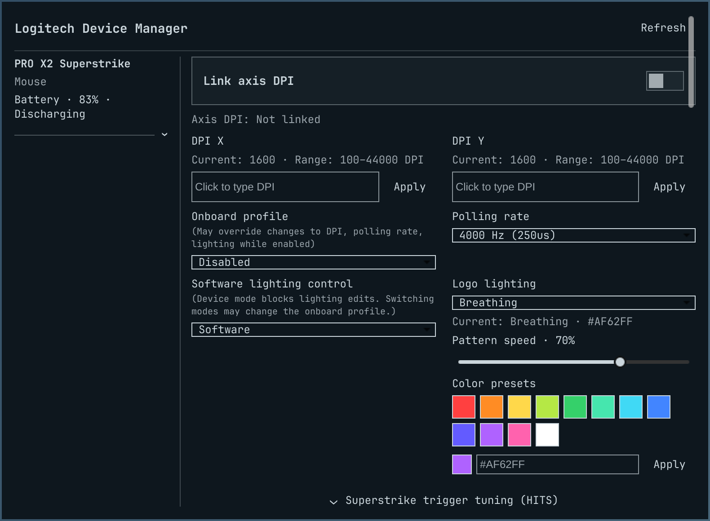

# Logitech Device Manager

An Omarchy 4.5 bar widget for compatible Logitech mice, keyboards, headsets,
microphones, and webcams. The panel shows the controls each connected device
exposes through its firmware and Linux backend.



*Preview with a simulated Logitech PRO X2 Superstrike.*

| Device | Available controls on supported models |
| --- | --- |
| Mouse | DPI (including separate X-axis and Y-axis settings) · onboard profiles · polling rate · RGB colors and effects · Superstrike trigger tuning |
| Keyboard | Onboard profiles · polling rate · RGB colors, effects, and speed |
| Headset | Volume and mute for playback and microphone · factory presets or custom EQ · inactivity power-off · lighting |
| Microphone | Input volume and mute · Yeti GX hardware gain · lighting |
| Webcam | Exposure, focus, and white balance · image adjustments · zoom, pan, and tilt · supported reset actions |

Wireless devices show battery level and charging state when the device reports
them. Controls vary by model, firmware, and connection type.

## Install

Install the backends for the devices you want to manage. Reconnect USB devices
after installing packages that supply udev rules.

| Backend | Used for |
| --- | --- |
| [Solaar](https://github.com/pwr-Solaar/Solaar) | HID++ settings and lighting (developed against Solaar 1.1.20) |
| `pactl` from `libpulse` | Playback and microphone controls through the active PipeWire-Pulse session |
| [HeadsetControl](https://github.com/Sapd/HeadsetControl#supported-devices) | Headset hardware features (requires JSON output and the `-d vendor:product` selector) |
| `v4l2-ctl` from `v4l-utils` | Webcam discovery and controls |

On Omarchy, the packages can be installed with:

```sh
omarchy pkg add solaar libpulse v4l-utils
omarchy pkg aur add headsetcontrol
```

Install and enable the plugin as your desktop user:

```sh
omarchy plugin add https://github.com/Z1Z0R/logitech-device-manager.git --enable
```

For a manual install from a checkout or an extracted archive, run these commands
from the plugin directory that contains `manifest.json`:

```sh
plugin_dir="$HOME/.config/omarchy/plugins/logitech-device-manager"
install -d "$plugin_dir/i18n"
install -m 644 manifest.json LogitechDeviceManager.qml backend.py README.md LICENSE panel-preview.png "$plugin_dir/"
install -m 644 i18n/en.json "$plugin_dir/i18n/"
omarchy-shell shell rescanPlugins
omarchy plugin enable logitech-device-manager --section right
```

To hide the widget, run `omarchy plugin disable logitech-device-manager`.

## Use the panel

Click the Logitech icon in the bar. Each device starts collapsed. Click its
divider or arrow to reveal its settings. The panel uses two settings columns
when space allows and one column on narrower screens. It follows the bar's
font and uses the theme's popup colors by default. In
`~/.config/omarchy/shell.toml`, explicit `[popups]` values for background color,
opacity, and text take priority. For each of those values, an explicit `[bar]`
override also applies if there is no corresponding popup override. Clear bar
mode keeps the panel background transparent.

- **DPI and onboard profiles.** Enter an exact supported DPI and press Enter or
  Apply. If your device has separate X-axis and Y-axis DPI settings,
  **Link axis DPI** starts off. The plugin remembers your choice across
  restarts when the device has a stable hardware ID. An active
  onboard profile can override manual DPI, polling rate, or lighting. The panel
  marks the applicable settings. Select **Disabled** in **Onboard profile** to
  switch to host control if a manual change does not apply.
- **Superstrike.** Expand **Superstrike trigger tuning (HITS)** for per-button
  actuation depth, rapid trigger, and click haptics. Release a slider to apply
  its value.
- **Lighting.** Choose a supported effect and, where available, a color preset,
  hex color, or speed. Click **Apply** to send the change. Some devices require
  **Software lighting control**. Taking control can also switch onboard profile
  mode on some firmware.
- **Audio.** The sliders adjust individual Logitech audio endpoints. Use the
  speaker and microphone icons to toggle mute. Supported headsets offer
  factory EQ profiles or Gaming, Music, Movie, and a locally saved Custom
  curve. An inactivity power-off value of zero disables the timer.
- **Webcams.** Numeric sliders snap to the reported increments and apply on
  release. Automatic exposure, white balance, or focus can lock its manual
  control. Change resolution and frame rate in the app using the camera.

The panel checks Linux battery readings about every 400 ms while open and
attempts a full refresh about every 1.25 seconds, allowing slow queries to finish
before starting another scan. Devices that report the same serial across wired
and wireless modes can retain their identity when switching connections.

## Troubleshooting

If a device or control is missing, run a scan to see what the backend detects:

```sh
python3 ~/.config/omarchy/plugins/logitech-device-manager/backend.py scan
```

An offline device may disappear until it reconnects. An audio endpoint and its
headset hardware controls may appear in separate cards. For write-only
settings, **Last set here** shows the last successful change in the current
shell session.

## License

[MIT](LICENSE)
